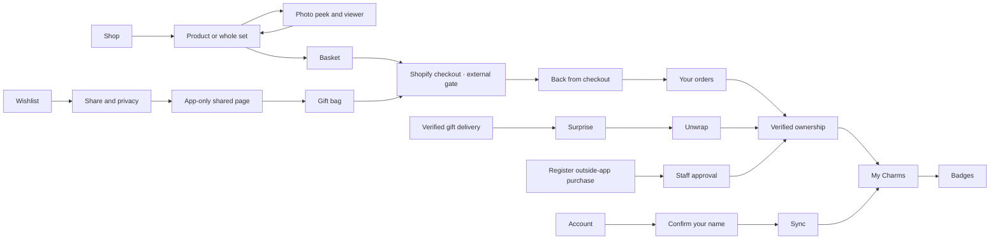

# Journey inventory · full candidate59

Start with the 71 launch design IDs below. Every available screen has a fresh current capture; external/gated routes have an explicit explanation. Additional IDs cover later onboarding, preview, Ways to wear, gift-card/order changes, native sheet openings and shipping-root evidence. Largest text and -more images use the same base ID.

| Launch screen ID | Current capture | Evidence / availability |
|---|---|---|
| G-01-splash | [G-01-splash](G-01-splash.jpg) | isolated current production SwiftUI content |
| G-02-welcome | [G-02-welcome](G-02-welcome.jpg) | isolated current production SwiftUI content |
| G-03-shopify-sign-in | [G-03-shopify-sign-in](G-03-shopify-sign-in.jpg) | isolated current production SwiftUI content |
| SHOPIFY-CODE | Not captured | External Shopify authentication/code page. No dedicated authorized Claire email-code session; no fabricated browser/authentication capture. |
| G-05-syncing-purchases | [G-05-syncing-purchases](G-05-syncing-purchases.jpg) | isolated current production SwiftUI content |
| G-06-purchases-found | [G-06-purchases-found](G-06-purchases-found.jpg) | isolated current production SwiftUI content |
| M-06-sync-zero | [M-06-sync-zero](M-06-sync-zero.jpg) | isolated current production SwiftUI content |
| M-09-sign-in-failed | [M-09-sign-in-failed](M-09-sign-in-failed.jpg) | isolated current production SwiftUI content |
| M-10-sync-failed | [M-10-sync-failed](M-10-sync-failed.jpg) | isolated current production SwiftUI content |
| S2-01-sets-feed | [S2-01-sets-feed](S2-01-sets-feed.jpg) | isolated current production SwiftUI content |
| S2-02-sets-feed-owned | [S2-02-sets-feed-owned](S2-02-sets-feed-owned.jpg) | isolated current production SwiftUI content |
| S2-03-sets-feed-in-basket | [S2-03-sets-feed-in-basket](S2-03-sets-feed-in-basket.jpg) | isolated current production SwiftUI content |
| S2-04-set-page | [S2-04-set-page](S2-04-set-page.jpg) | isolated current production SwiftUI content |
| C-01-charms-feed | [C-01-charms-feed](C-01-charms-feed.jpg) | isolated current production SwiftUI content |
| C-05-charms-feed-no-set | [C-05-charms-feed-no-set](C-05-charms-feed-no-set.jpg) | isolated current production SwiftUI content |
| C-02-charms-added | [C-02-charms-added](C-02-charms-added.jpg) | isolated current production SwiftUI content |
| C-03-charm-page | [C-03-charm-page](C-03-charm-page.jpg) | isolated current production SwiftUI content |
| C-04-charm-page-no-set | [C-04-charm-page-no-set](C-04-charm-page-no-set.jpg) | isolated current production SwiftUI content |
| G-11-quick-add | [G-11-quick-add](G-11-quick-add.jpg) | isolated current production SwiftUI content |
| E-01-earrings-feed | [E-01-earrings-feed](E-01-earrings-feed.jpg) | isolated current production SwiftUI content |
| E-02-earring-page | [E-02-earring-page](E-02-earring-page.jpg) | isolated current production SwiftUI content |
| H-01-hot-set | [H-01-hot-set](H-01-hot-set.jpg) | isolated current production SwiftUI content |
| H-02-hot-charm | [H-02-hot-charm](H-02-hot-charm.jpg) | isolated current production SwiftUI content |
| H-03-hot-earrings | [H-03-hot-earrings](H-03-hot-earrings.jpg) | isolated current production SwiftUI content |
| A-01-feed | [A-01-feed](A-01-feed.jpg) | isolated current production SwiftUI content |
| A-01-page | [A-01-page](A-01-page.jpg) | isolated current production SwiftUI content |
| A-02-feed | [A-02-feed](A-02-feed.jpg) | isolated current production SwiftUI content |
| A-02-page | [A-02-page](A-02-page.jpg) | isolated current production SwiftUI content |
| G-25A-search-focus | [G-25A-search-focus](G-25A-search-focus.jpg) | isolated current production SwiftUI content |
| G-25B-search-typing | [G-25B-search-typing](G-25B-search-typing.jpg) | isolated current production SwiftUI content |
| G-25-search | [G-25-search](G-25-search.jpg) | isolated current production SwiftUI content |
| G-25C-search-filters | [G-25C-search-filters](G-25C-search-filters.jpg) | isolated current production SwiftUI content |
| G-25D-search-filtered | [G-25D-search-filtered](G-25D-search-filtered.jpg) | isolated current production SwiftUI content |
| G-25E-search-no-results | [G-25E-search-no-results](G-25E-search-no-results.jpg) | isolated current production SwiftUI content |
| G-35-basket-sheet | [G-35-basket-sheet](G-35-basket-sheet.jpg) | isolated current production SwiftUI content |
| G-35U-basket-removal-undo | [G-35U-basket-removal-undo](G-35U-basket-removal-undo.jpg) | isolated current production SwiftUI content |
| G-35E-basket-empty | [G-35E-basket-empty](G-35E-basket-empty.jpg) | isolated current production SwiftUI content |
| M-12-basket-quote-failed | [M-12-basket-quote-failed](M-12-basket-quote-failed.jpg) | isolated current production SwiftUI content |
| SHOPIFY-CHECKOUT | Not captured | External Shopify payment. No unpaid authorized customer checkout staged for this full review; no order or payment created. |
| M-05-checkout-return | [M-05-checkout-return](M-05-checkout-return.jpg) | isolated current production SwiftUI content |
| G-14-my-charms | [G-14-my-charms](G-14-my-charms.jpg) | isolated current production SwiftUI content |
| G-14B-my-charms-sets | [G-14B-my-charms-sets](G-14B-my-charms-sets.jpg) | isolated current production SwiftUI content |
| G-14C-my-charms-everything-else | [G-14C-my-charms-everything-else](G-14C-my-charms-everything-else.jpg) | isolated current production SwiftUI content |
| G-17-set-complete | [G-17-set-complete](G-17-set-complete.jpg) | isolated current production SwiftUI content |
| G-18-share-the-stack | [G-18-share-the-stack](G-18-share-the-stack.jpg) | isolated current production SwiftUI content |
| OFFLINE-REGISTRATION | [OFFLINE-REGISTRATION](OFFLINE-REGISTRATION.jpg) | isolated current production SwiftUI content |
| M-07-registration-history | [M-07-registration-history](M-07-registration-history.jpg) | isolated current production SwiftUI content |
| G-19-achievements | [G-19-achievements](G-19-achievements.jpg) | isolated current production SwiftUI content |
| BUILD29-BADGE-DETAIL | [BUILD29-BADGE-DETAIL](BUILD29-BADGE-DETAIL.jpg) | isolated current production SwiftUI content |
| G-31-badge-catalogue | [G-31-badge-catalogue](G-31-badge-catalogue.jpg) | isolated current production SwiftUI content |
| L-01-wishlist-share | [L-01-wishlist-share](L-01-wishlist-share.jpg) | isolated current production SwiftUI content |
| M-01-sharing-privacy | [M-01-sharing-privacy](M-01-sharing-privacy.jpg) | isolated current production SwiftUI content |
| M-02-private-review | [M-02-private-review](M-02-private-review.jpg) | isolated current production SwiftUI content |
| L-02-gift-push | [L-02-gift-push](L-02-gift-push.jpg) | synthetic push presentation only; no APNs or lock-screen delivery claim |
| L-03-gift-surprise | [L-03-gift-surprise](L-03-gift-surprise.jpg) | isolated current production SwiftUI content |
| L-04-ready-to-unwrap | [L-04-ready-to-unwrap](L-04-ready-to-unwrap.jpg) | isolated current production SwiftUI content |
| L-05-unwrapped | [L-05-unwrapped](L-05-unwrapped.jpg) | isolated current production SwiftUI content |
| G-34-share-badge | [G-34-share-badge](G-34-share-badge.jpg) | isolated current production SwiftUI content |
| W-01-shared-wishlist | [W-01-shared-wishlist](W-01-shared-wishlist.jpg) | current production web templates / synthetic loopback service / CUA browser |
| W-02-gift-bag | [W-02-gift-bag](W-02-gift-bag.jpg) | current production web templates / synthetic loopback service / CUA browser |
| W-03-gift-thanks | [W-03-gift-thanks](W-03-gift-thanks.jpg) | current production web templates / synthetic loopback service / CUA browser |
| W-04-shared-stack | [W-04-shared-stack](W-04-shared-stack.jpg) | current production web templates / synthetic loopback service / CUA browser |
| W-06-private-link | [W-06-private-link](W-06-private-link.jpg) | current production web templates / synthetic loopback service / CUA browser |
| W-07-app-first-open | [W-07-app-first-open](W-07-app-first-open.jpg) | isolated current production SwiftUI content |
| G-24-settings | [G-24-settings](G-24-settings.jpg) | isolated current production SwiftUI content |
| G-24-more-settings | [G-24-more-settings](G-24-more-settings.jpg) | isolated current production SwiftUI content |
| BUILD29-FIRST-NAME | [BUILD29-FIRST-NAME](BUILD29-FIRST-NAME.jpg) | isolated current production SwiftUI content |
| M-03-your-orders | [M-03-your-orders](M-03-your-orders.jpg) | isolated current production SwiftUI content |
| M-04-your-orders-empty | [M-04-your-orders-empty](M-04-your-orders-empty.jpg) | isolated current production SwiftUI content |
| M-08-delete-account | [M-08-delete-account](M-08-delete-account.jpg) | isolated current production SwiftUI content |
| M-11-offline | [M-11-offline](M-11-offline.jpg) | isolated current production SwiftUI content |

## Journey map

Purchases, ownership, delivery and quotes in this pack are isolated examples. External payment, authentication and real delivery are not proven by the screenshots.

## Additional journeys

| Journey | Captures, including continuations | Review focus |
|---|---:|---|
| AppRoot proofs | 42 | Actual app tab ancestor, keyboard and native presentation; native viewport |
| Badges and shares | 58 | Shelf, badge detail, founding collector, earn/share/export |
| Basket | 54 | Confirmed, empty, undo, quote failure, sold out, sets, gift-card editing |
| Gift cards | 10 | Existing denominations, recipient form, scheduling and confirmed result |
| My Charms | 40 | 23-piece collection, set progress, loose provenance, empty filter and offline |
| Onboarding | 50 | Welcome, Shopify boundary, sync, chosen name, keyboard and recovery |
| Orders | 35 | Awaiting payment, paid, scheduled processing/verified fulfilment and empty orders |
| Photo and Ways to wear | 13 | Photo peek/viewer; full-width native explainer, largest text |
| Registration | 11 | Product/hardware/source, pop-up copy, receipt, submission/history |
| Search | 86 | Keyboard focus/content, live filtering, filters and no results |
| Settings and privacy | 104 | Account, alert state, controls, diagnostics, deletion and gated feedback |
| Shop | 164 | Sets, Charms, Earrings, Hot, chains/accessories; exact options and coloured gold covers |
| Web sharing | 29 | Public/private/paid wishlist, gift bag/thanks, badge/stack, privacy and OG |
| Wishlist and gifting | 34 | Wishlist privacy, alert permission, surprise/unwrap/reveal, prepared feedback |

## Gates and deliberate exclusions

- **LG-04-explainer-timing** — Authenticated account-scoped first-run recording needs service59 deployment and an authorized customer session. Implementation/isolated tests exist; live first-run video is not claimed.
- **F-50-Safari-reopen** — Associated-link domain and real Safari/device acceptance remain infrastructure work.
- **SHEET-add-bestie** — Parked at launch; besties/Club/rewards deliberately switched off.
- **SHOPIFY-CHECKOUT** — External Shopify payment. No unpaid authorized customer checkout staged for this full review; no order or payment created.
- **SHOPIFY-CODE** — External Shopify authentication/code page. No dedicated authorized Claire email-code session; no fabricated browser/authentication capture.
- **SYSTEM-notification-permission** — System alert and real APNs delivery require physical-device verification; synthetic gift push is not an APNs pass.
- **SYSTEM-photos-permission** — System Photos authorization varies per physical device. Simulator/content renders are not device permission or Save Video acceptance.
- **W-05-bestie-invite** — Parked at launch; no bestie-code route shown as customer launch functionality.

The collection examples do not grant production ownership. Gifts stay anonymous until verified delivery and unwrap; recipient contact data is not projected publicly. Current Shopify denominations and prices override design placeholders. See RESPONSE.md and CONTENT-REVIEW.md for remaining infrastructure and merchant work.
